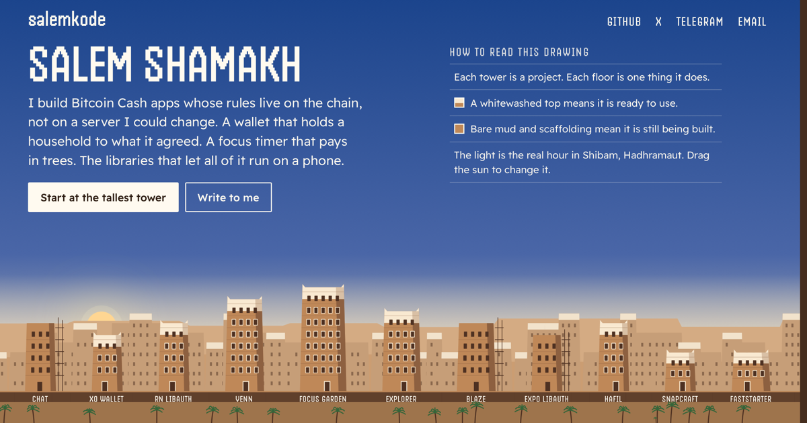

# salemkode.com

My site, drawn as one picture of Shibam, Hadhramaut. Each tower is a project and each floor is one thing that project does.



## How to read it

- A whitewashed top means the project is ready to use. Bare mud and scaffolding mean it is still being built.
- The light is the real position of the sun over Shibam. Drag the sun (or focus it and use the arrow keys) to change the hour; **Back to now** returns to the real time.
- The sheet is dated with the current Bitcoin Cash block, read from the public Chaingraph server the Explorer uses by default. A window lights up when a new block arrives.
- A palm grows in the wadi for every minute you stay. Leave the tab for more than ten seconds and the young one withers, as a tree does in Focus Garden.
- Point at a floor in the list and its windows light up in the tower.

## Run it

There is no build step and no dependency. Serve the folder with anything:

```sh
python3 -m http.server 4173
```

Then open http://localhost:4173. Opening `index.html` straight from disk also works, but browsers block the fonts there.

## Add or change a project

Everything is in `index.html`.

1. Copy an `<article class="plot">` and give it a new `id`.
2. Write one `<li>` per floor inside `<ol class="floors">`, top floor first. The tower gets one storey per item.
3. Set `data-cols` (3 to 5) for the tower's width. Add `data-live` when the project is ready to use; leave it off for bare mud and scaffolding. `data-old` draws a lower house for the old quarter.
4. Add a link to it in `<nav class="plates">`. The order of those links is the order of the towers, west to east.

`main.js` draws the city from that markup. `styles.css` holds the noon colours; the script replaces them as the sun moves.

Without JavaScript the page is a plain list of the same projects.

## Deploy

Pushing to `main` publishes the folder to GitHub Pages through `.github/workflows/deploy.yml`.

## Credits

Type is [Handjet](https://fonts.google.com/specimen/Handjet) and [Readex Pro](https://fonts.google.com/specimen/Readex+Pro), both under the SIL Open Font License and served from `fonts/`.
